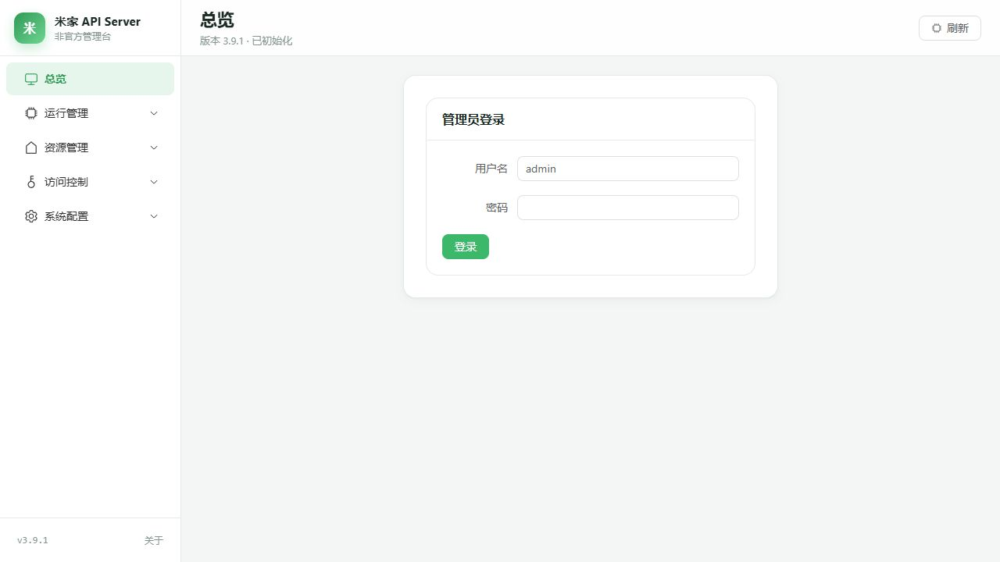
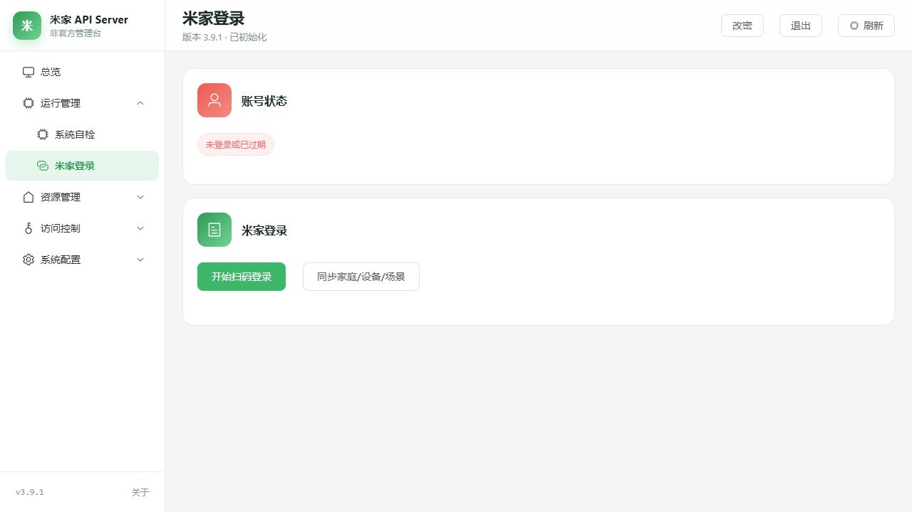
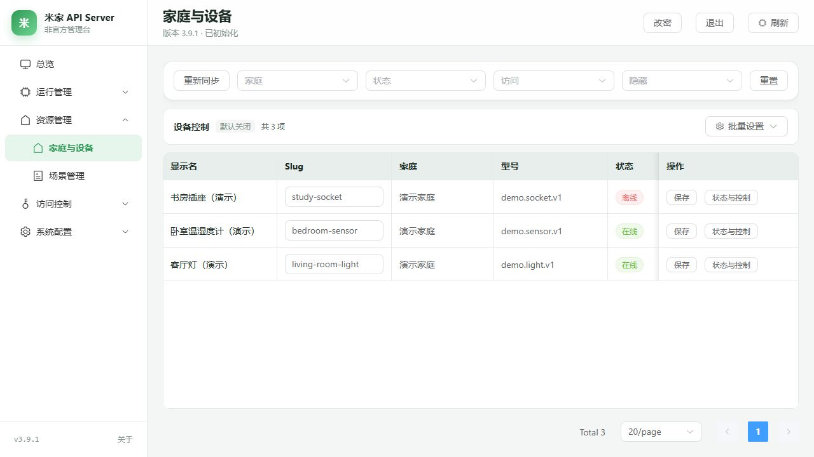
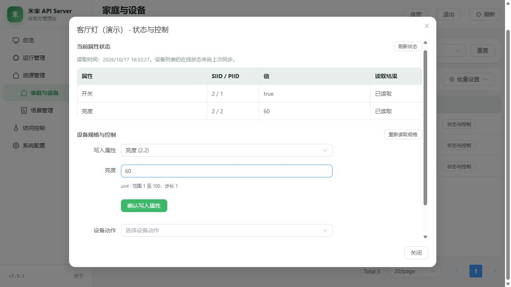
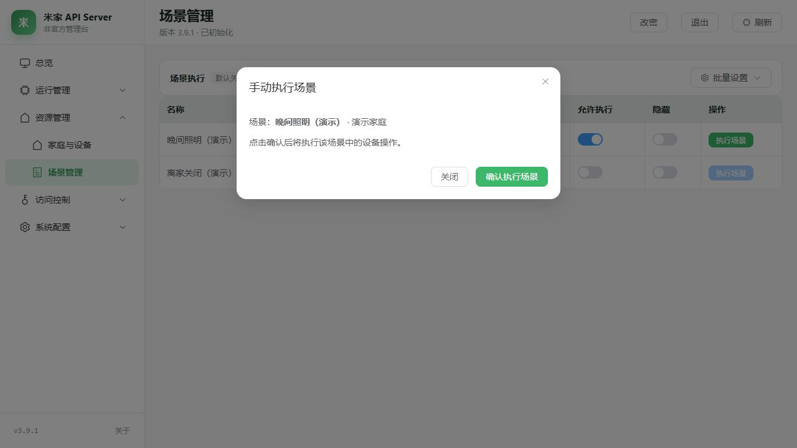
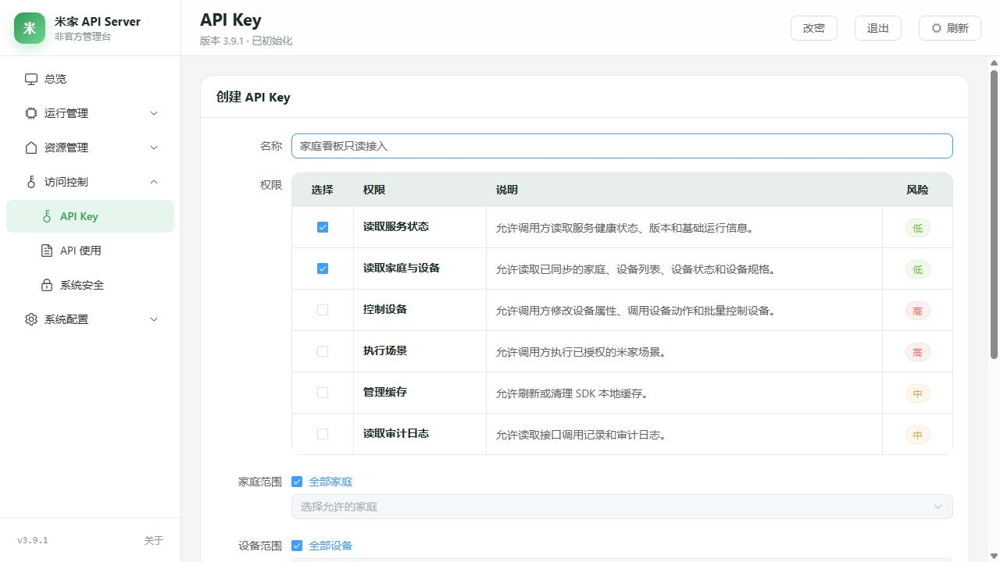
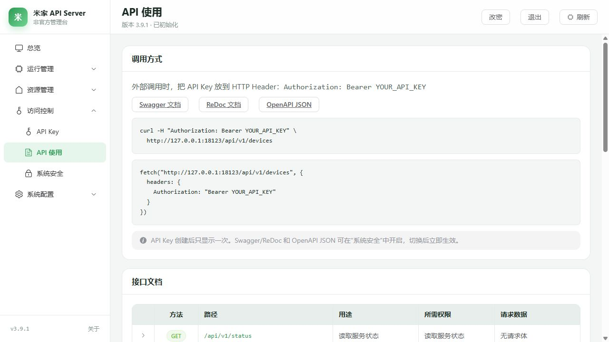

# 米家 API SDK & Server

[](https://www.python.org/downloads/)
[](LICENSE)

> **非官方第三方项目。** 与小米 / 米家无隶属或授权关系。仅操作你有权控制的账号与设备，并遵守平台用户协议。详见 [免责声明与使用边界](DISCLAIMER.md)。

第三方米家智能家居 Python SDK，内置 FastAPI + Vue3 管理后台。

**[图文教程](#管理台图文教程)** · [下载运行](#下载运行) · [快速部署](#快速部署) · [API 接入](#对外-api) · [完整文档](docs/README.md)

**两种使用形态：**

| 形态 | 说明 |
|------|------|
| **SDK** | 在 Python 项目中直接调用米家登录、设备控制、场景执行等能力 |
| **API Server** | 部署为本地/服务器服务，通过网页管理，对外提供 HTTP API |

> 管理台默认监听 `127.0.0.1:8123`，公网使用需开启访问开关并建议搭配 HTTPS 反向代理。

## 管理台图文教程

**[查看完整教程（含配置与故障排查）](docs/使用指南/07-管理台图文教程.md)**

以下截图使用演示数据，访问地址请替换为自己的服务地址。

### 1. 登录管理员

打开管理台，输入管理员账号和密码。首次使用时，先按页面提示创建管理员。



### 2. 登录米家并同步资源

进入「运行管理 → 米家登录」，点击「开始扫码登录」，用米家 App 扫码确认，再点击「同步家庭/设备/场景」。



### 3. 查看和管理设备

进入「资源管理 → 家庭与设备」，按家庭筛选设备。修改 `Slug` 后点击该行「保存」；需要控制设备时，向右滚动表格，将「访问」设为「可控」。



### 4. 读取状态并控制设备

点击「状态与控制」查看当前属性。选择可写属性或动作、填写参数后，点击「确认写入属性」或「确认执行动作」。只读或隐藏设备无法控制。



### 5. 执行场景

进入「场景管理」，为需要的场景开启「允许执行」并关闭「隐藏」。点击「执行场景」，核对名称和家庭后点击「确认执行场景」。



### 6. 创建 API Key

进入「访问控制 → API Key」，填写名称，先选择「读取服务状态」「读取家庭与设备」，设置资源范围和有效期后点击「创建」。完整密钥只显示一次，请及时保存。



### 7. 调用 API

进入「访问控制 → API 使用」，查看接口说明和请求示例。使用新建的 Key 调用 `GET /api/v1/devices`，请求头为 `Authorization: Bearer YOUR_API_KEY`。



## 快速部署

### 环境要求

- Python 3.9+ / uv
- Node.js 18+ / npm

### 一键启动

```bash
# GitHub（海外网络）
git clone git@github.com:cuckoo711/mijiaAPI_V2.git
cd mijiaAPI_V2

# 或 Gitee 镜像（国内网络；克隆目录名为 mijiaAPI）
# git clone https://gitee.com/cuckoo711/mijiaAPI.git
# git clone git@gitee.com:cuckoo711/mijiaAPI.git
# cd mijiaAPI

# 安装依赖 & 构建前端
uv sync && cd web && npm ci && npm run build && cd ..

# 初始化 & 启动
uv run python -m server.cli init
uv run python -m server.cli run
```

打开 `http://127.0.0.1:8123` → 创建管理员 → 扫码登录米家 → 同步家庭/设备/场景 → 开始使用。

## 核心功能

| 功能 | 说明 |
|------|------|
| 扫码登录 | 米家 App 扫码，凭据自动保存和刷新 |
| 设备管理 | 家庭/设备列表、实时属性状态、按规格手动写入属性与执行动作、隐藏/只读控制 |
| 场景控制 | 场景列表、明确确认后手动执行、权限管理 |
| API Key | 创建/启停/删除，细粒度权限控制 |
| 实时同步进度 | 同步时显示进度条、步骤、设备/场景计数 |
| 安全策略 | 局域网/公网访问控制、可信代理、凭据加密与操作审计 |
| 管理改密 | 管理台改密 + CLI `reset-admin` |

## 对外 API

```bash
# 基本用法
curl -H "Authorization: Bearer YOUR_API_KEY" \
  http://127.0.0.1:8123/api/v1/devices
```

| 方法 | 路径 | 说明 |
|------|------|------|
| `GET` | `/api/v1/status` | 服务状态 |
| `GET` | `/api/v1/account` | 当前凭据对应的小米账号信息 |
| `GET` | `/api/v1/homes` | 家庭列表 |
| `GET` | `/api/v1/devices` | 设备列表（可选 `include_spec` / `include_raw`） |
| `GET` | `/api/v1/devices/{slug}` | 单个设备详情 |
| `GET` | `/api/v1/devices/{slug}/state` | 设备状态 |
| `GET` | `/api/v1/devices/{slug}/spec` | 设备规格（属性/动作定义） |
| `POST` | `/api/v1/devices/{slug}/properties` | 控制设备 |
| `POST` | `/api/v1/devices/{slug}/actions` | 执行动作 |
| `POST` | `/api/v1/batch/devices/properties` | 批量写入设备属性 |
| `GET` | `/api/v1/scenes` | 场景列表 |
| `POST` | `/api/v1/scenes/{id}/execute` | 执行场景 |
| `GET` | `/api/v1/logs` | 审计日志 |
| `GET` | `/api/v1/operations/{operation_id}` | 查询当前 API Key 自己发起的控制操作回执 |
| `POST` | `/api/v1/cache/refresh` | 刷新指定家庭或全部缓存 |
| `POST` | `/api/v1/cache/clear` | 清除缓存 |

管理台「API 使用」页面有完整的请求示例和参数说明。交互式文档（Swagger/ReDoc）可在「系统安全」中开启。

控制请求出现 `409 EXECUTION_UNKNOWN` 时，命令可能已送达，服务不会自动重发；请先查询设备状态或场景效果，再决定后续操作。查询请求与发送前的连接失败仍可重试。

批量属性、密钥轮换、管理员接口与操作回执见 [API Server 接口说明](docs/开发指南/05-API-Server-开发启动.md#常用接口)。

## SDK 使用

```python
from mijiaAPI_V2 import create_api_client_from_file

# 加载凭据并创建客户端
api = create_api_client_from_file()

# 获取家庭和设备
homes = api.get_homes()
devices = api.get_devices(homes[0].id)

# 控制设备
api.control_device(device_id=devices[0].did, siid=2, piid=1, value=True)
```

更多示例见 `examples/` 目录。

## 环境变量

| 变量 | 默认值 | 说明 |
|------|--------|------|
| `MIJIA_SERVER_HOST` | `127.0.0.1` | 监听地址 |
| `MIJIA_SERVER_PORT` | `8123` | 监听端口 |
| `MIJIA_SERVER_DATA_DIR` | `configs` | 数据目录 |
| `MIJIA_SERVER_DATABASE_PATH` | `configs/server/server.sqlite3` | SQLite 路径 |
| `MIJIA_CREDENTIAL_PATH` | `configs/credential.json` | 凭据文件（AES-GCM 加密） |
| `MIJIA_WEB_DIST_DIR` | `web/dist` | 前端静态资源 |
| `MIJIA_SERVER_LOG_LEVEL` | `INFO` | 日志级别（支持 `DEBUG`） |
| `MIJIA_SERVER_ACCESS_LOG` | 关闭 | `1` 时启用 uvicorn access log（等同 `run --access-log`） |
| `MIJIA_PUBLIC_BASE_URL` | 空 | 对外基础 URL（生成绝对链接时使用） |
| `MIJIA_AUDIT_RETENTION_DAYS` | `30` | 审计日志保留天数 |
| `MIJIA_ADMIN_SESSION_HOURS` | `12` | 管理台会话有效期（小时） |
| `MIJIA_CREDENTIAL_REFRESH_BEFORE_SECONDS` | 见配置 | 凭据到期前多久触发自动刷新 |
| `MIJIA_BOOTSTRAP_ALLOW_PRIVATE` | 空 | `1` 时允许未初始化实例从私网首次建管理员，并原子启用局域网访问策略（Docker）；不启用公网 |
| `MIJIA_CREDENTIAL_SECRET` | 空 | 可选凭据加密密钥；不设则用 `.credential_key` |

也可编辑 `configs/server.toml`（可用 `python -m server.cli write-config` 生成）；环境变量优先。

### 常用 CLI

```bash
uv run python -m server.cli init
uv run python -m server.cli run
uv run python -m server.cli check
uv run python -m server.cli diagnose        # 导出诊断数据（可加 --output）
uv run python -m server.cli status          # 版本 / 路径 / 磁盘占用
uv run python -m server.cli reset-admin     # 本机重置管理员密码
uv run python -m server.cli purge-audit
uv run python -m server.cli purge-cache     # 可加 --all
uv run python -m server.cli write-config
```

## 部署

### Docker Compose

在仓库根目录执行即可构建并后台启动：

```bash
docker compose -f deploy/docker-compose.yml up -d --build
```

默认只绑定本机 `127.0.0.1:8123`，启动后访问 `http://127.0.0.1:8123`。数据、SQLite 数据库、米家凭据、加密密钥和缓存持久化在命名卷 `mijia-data` 中。

Docker 会把宿主回环 HTTP 转为容器的私网来源。Compose 默认设置 `MIJIA_BOOTSTRAP_ALLOW_PRIVATE=1`，仅在尚无管理员时放行首页、静态资源和首次创建入口；首次私网创建管理员会同时启用 `ALLOW_LAN_ACCESS`，使随后登录可用，`ALLOW_PUBLIC_ACCESS` 仍关闭。已有管理员的实例不会因该变量自动修改访问策略。

> 从 v3.7.3 及更早版本升级的实例，旧卷名是 `deploy_mijia-data`，需要按
> [`deploy/README.md`](deploy/README.md#从旧卷名迁移仅影响-v373-及更早已部署的实例) 搬迁一次，否则会挂到空卷。

首次创建管理员可以直接打开管理台，或执行：

```bash
docker compose -f deploy/docker-compose.yml run --rm mijia-server mijia-server init --admin admin --allow-lan
```

常用维护命令：

```bash
docker compose -f deploy/docker-compose.yml ps
docker compose -f deploy/docker-compose.yml logs -f mijia-server
docker compose -f deploy/docker-compose.yml down
docker compose -f deploy/docker-compose.yml up -d --build
```

如需从局域网访问，在 `deploy/` 目录（compose 文件旁边）创建未提交的 `.env`，例如：

```dotenv
MIJIA_BIND_ADDRESS=0.0.0.0
MIJIA_HOST_PORT=8123
MIJIA_BOOTSTRAP_ALLOW_PRIVATE=0
MIJIA_SERVER_LOG_LEVEL=INFO
```

改为非本机绑定后，建议关闭私网首次创建入口，使用容器内 `init --admin admin --allow-lan` 创建管理员并明确启用局域网策略。更多说明见 [`deploy/README.md`](deploy/README.md)。

### systemd

仓库提供加固示例单元，见 [`deploy/mijia-server.service`](deploy/mijia-server.service) 与
[`deploy/mijia-server.env.example`](deploy/mijia-server.env.example)。

```bash
sudo cp deploy/mijia-server.service /etc/systemd/system/
sudo cp deploy/mijia-server.env.example /etc/mijia-server.env
# 按需修改路径与 User=
sudo systemctl daemon-reload
sudo systemctl enable --now mijia-server
```

默认仅监听 `127.0.0.1`。若经 Nginx 反代并需要按真实客户端 IP 做网络策略，请在管理台开启
`TRUST_PROXY_HEADERS`，并正确配置 `TRUSTED_PROXY_CIDRS`。

### Nginx 反向代理

```nginx
server {
    listen 443 ssl http2;
    server_name miapi.example.com;
    ssl_certificate /path/to/fullchain.pem;
    ssl_certificate_key /path/to/privkey.pem;

    location / {
        proxy_pass http://127.0.0.1:8123;
        proxy_set_header X-Real-IP $remote_addr;
        proxy_set_header X-Forwarded-For $proxy_add_x_forwarded_for;
    }
}
```

## 下载运行

从 [GitHub 发行版](https://github.com/cuckoo711/mijiaAPI_V2/releases) 或 [Gitee 发行版](https://gitee.com/cuckoo711/mijiaAPI/releases) 下载对应程序，无需安装 Python。

| 平台 | 架构 | 产物 |
|------|------|------|
| Windows | x64 | `mijia-server-windows-x64.exe` |
| Linux | x64 | `mijia-server-linux-x64` |
| Linux | ARM64 | `mijia-server-linux-arm64` |
| macOS | ARM64 | `mijia-server-macos-arm64` |

发行版同时提供 `SHA256SUMS`，可用于核对下载文件。Intel Mac 请按上方步骤从源码运行。

Android 7.0 及以上可选择最新 `android-test` 测试版的 `universal` 通用 APK，安装方法见 [Android 说明](android/README.md#使用)。

### 运行可执行文件

```bash
# Linux x64 示例；ARM64/macOS 请替换为上表中的对应文件名
chmod +x mijia-server-linux-x64
./mijia-server-linux-x64 init
./mijia-server-linux-x64 run
```

```powershell
# Windows x64
.\mijia-server-windows-x64.exe init
.\mijia-server-windows-x64.exe run
```

默认监听 `127.0.0.1:8123`。

## 完整文档

| 分类 | 文档 |
|------|------|
| 管理台图文教程 | [完整操作步骤与截图](docs/使用指南/07-管理台图文教程.md) |
| 文档索引 | [docs/README.md](docs/README.md) |
| 快速开始 / 配置 / 最佳实践 | [docs/使用指南/](docs/使用指南/) |
| SDK 与领域模型 / 异常 | [docs/API参考/](docs/API参考/) |
| 架构与开发 | [docs/架构设计/](docs/架构设计/) · [docs/开发指南/](docs/开发指南/) |
| 部署运维 | [deploy/README.md](deploy/README.md) |
| 故障排查 | [docs/故障排查指南.md](docs/故障排查指南.md) |
| 示例代码 | [examples/README.md](examples/README.md) |
| Android 测试版 | [android/README.md](android/README.md) |
| 构建与发布 | [打包与自动发布](deploy/README.md#打包pyinstaller) · [Gitee 镜像维护](deploy/scripts/README.md#3-gitee-release-镜像) |

## 常见问题

**同步按钮可以连续点吗？** 前端会禁用按钮，后端返回 `409 SYNC_IN_PROGRESS`；进度接口按 `task_id` 区分轮次。

**API 返回 `NETWORK_ACCESS_DENIED`？** 需在「系统安全」开启局域网/公网请求。策略覆盖管理台与对外 API。

**API Key 创建后还能查看完整密钥吗？** 不能，只在创建时显示一次。

**忘记管理员密码？** 本机执行 `python -m server.cli reset-admin`。

**管理台登录态存在哪？** HttpOnly Cookie（`mijia_admin_session`）+ CSRF；不要跨域依赖 Cookie。

**支持 Docker 吗？** 支持：`docker compose -f deploy/docker-compose.yml up -d --build`，详见 [`deploy/README.md`](deploy/README.md)。
