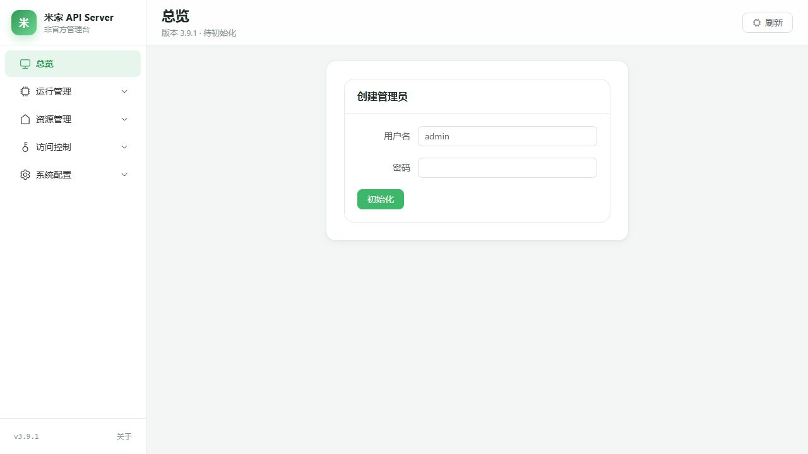
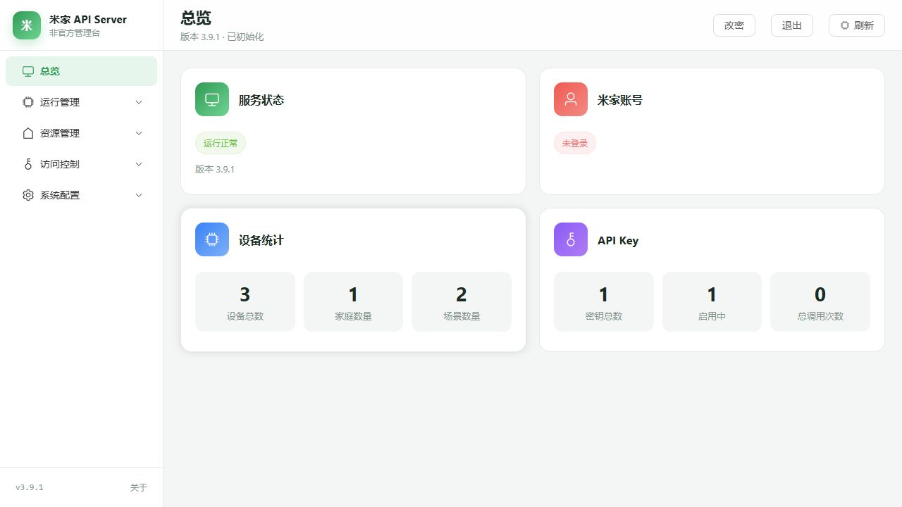
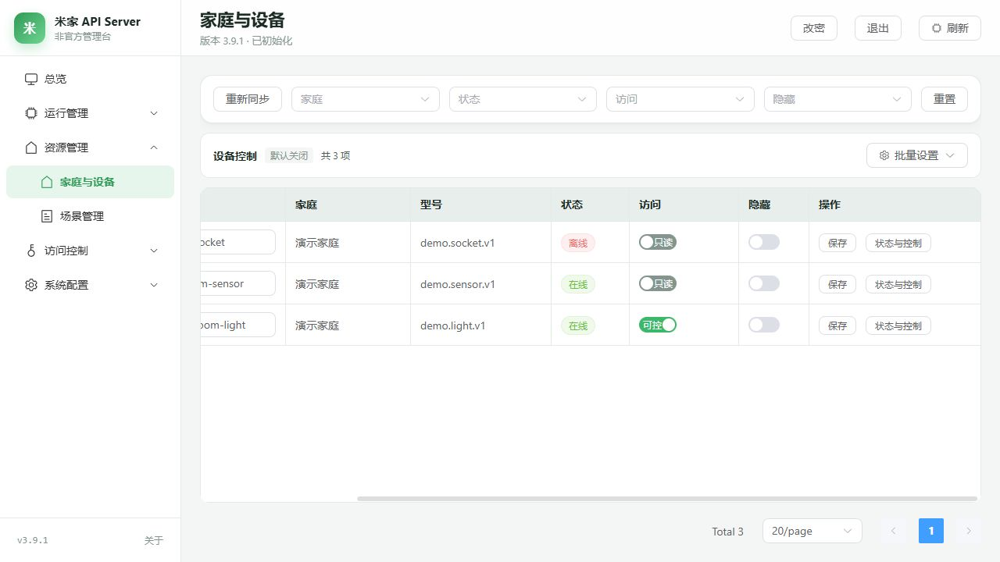
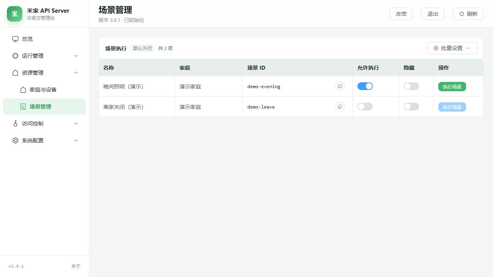
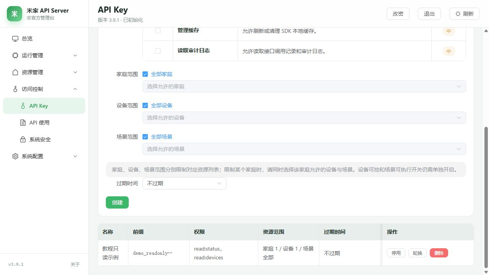
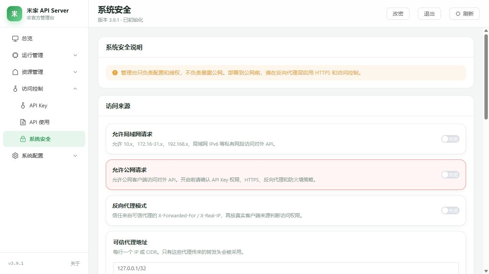
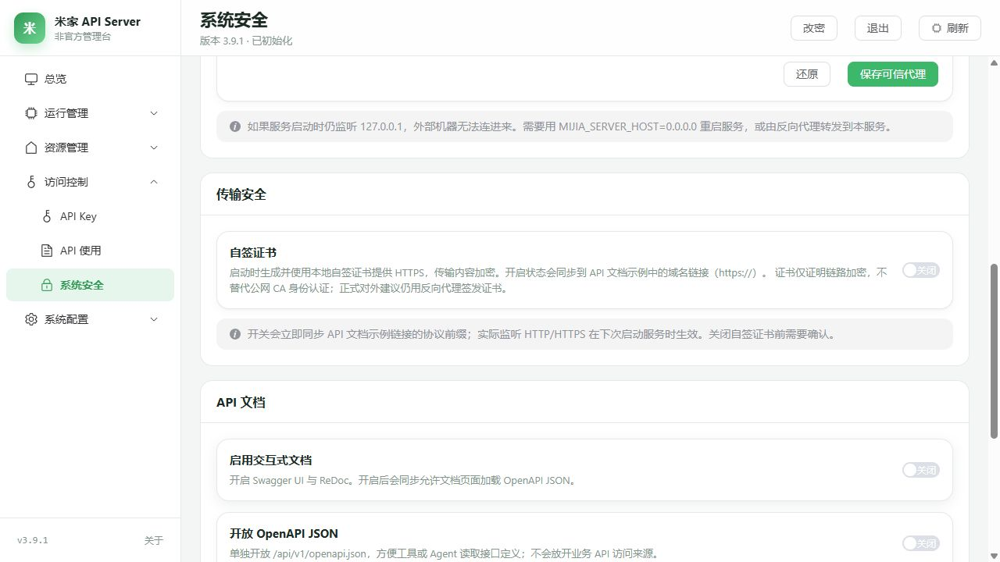
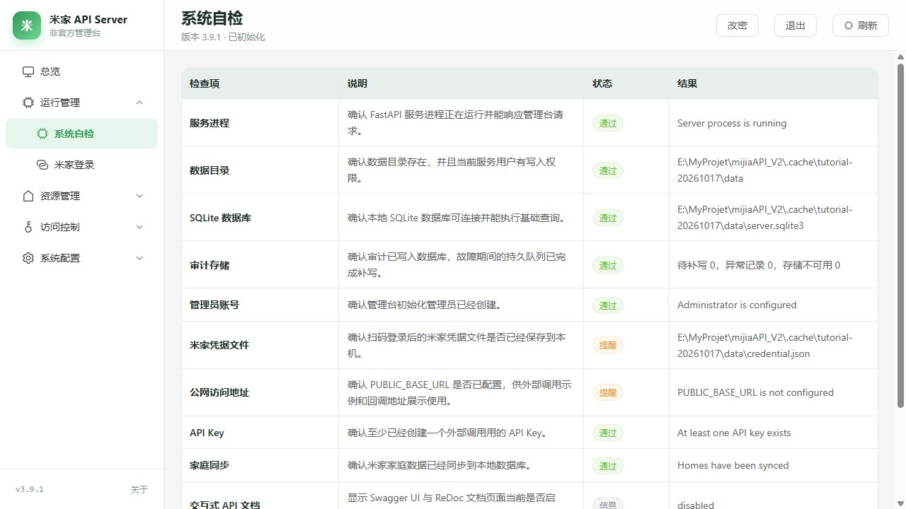
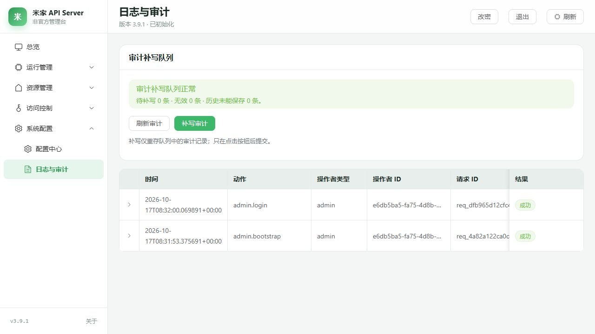
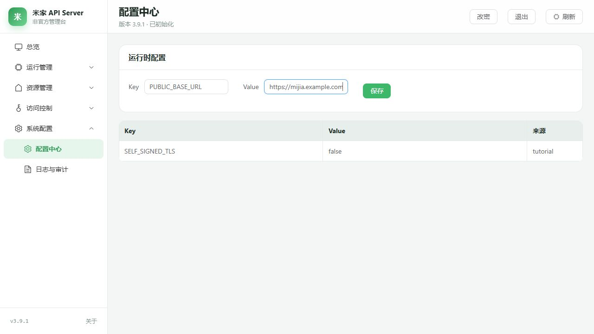

# 管理台图文使用教程

通过管理台完成米家授权、资源同步、设备与场景管理，以及 API 接入。截图使用演示数据，图中的地址请替换为自己的服务地址。

推荐顺序：**登录管理员 → 米家扫码 → 同步资源 → 查看设备 → 创建 API Key → 调用 API**。仅使用 Python SDK 请看[快速开始](01-快速开始.md)。

## 1. 打开服务并登录管理员

启动服务后，用浏览器打开部署地址。默认监听 `127.0.0.1:8123`，HTTP/HTTPS 以启动日志或部署配置为准。

首次使用且尚无管理员时，输入用户名与密码，点击“初始化”。用户名至少 3 个字符，密码至少 8 个字符。初始化只需完成一次；已有管理员的服务直接进入登录步骤。



出现“管理员登录”后，填写管理员用户名、密码，点击“登录”。登录成功后可查看总览；右上角“改密”用于修改管理员密码，“退出”用于结束管理台会话。


管理员账号用于登录本服务；米家账号用于授权读取和操作家庭资源。

页面打不开时检查服务进程、端口和访问地址。首次初始化提示仅允许本机访问时，在服务器本机完成；Docker/私网部署见[首次创建管理员](../../deploy/README.md#首次创建管理员)。

## 2. 从总览了解当前状态

总览展示“服务状态”“米家账号”“设备统计”和“API Key”。先看服务版本与运行状态，再核对账号有效性、家庭/设备/场景数量。左侧导航按运行管理、资源管理、访问控制、系统配置分组；窄屏可用左上角导航按钮展开菜单。



刚初始化或尚未同步时，资源数量为零属于正常现象。账号未登录或凭据过期时，先完成米家扫码。

## 3. 登录米家并同步家庭、设备和场景

进入“运行管理 → 米家登录”，点击“开始扫码登录”；已有凭据时按钮为“重新扫码登录”。用米家 App 扫码确认，等待显示“登录成功”，再点击“同步家庭/设备/场景”。


同步进度变为“已完成”后，家庭、设备和场景列表会更新。出现警告时查看对应家庭和错误详情。

二维码失效时点击“重新扫码登录”；读取状态异常时点击“重试读取状态”。同步进度读取失败时，先点击“刷新同步进度”。

“移除账号”会删除本地米家凭据，并清理该账号的家庭、设备、场景及 SDK 缓存；之后需重新登录和同步。

## 4. 整理设备标识与控制权限

进入“资源管理 → 家庭与设备”，可按家庭、状态、访问、隐藏条件筛选；“重置”清除筛选。“重新同步”用于更新米家资源。设备显示名来自同步信息；需要修改 API 使用的设备标识时，编辑 `Slug` 后点击该行“保存”。


“访问”默认为只读。将需要操作的设备切换为“可控”，开关会自动保存；“隐藏”开关也自动保存。隐藏设备不会出现在对外设备列表中，管理台仍可看到并查看状态，但不能直接控制。

窗口较窄时，在设备表格底部向右横向滚动，即可看到“访问”和“隐藏”列。



“批量设置”可全部开启或关闭设备控制，弹窗确认后生效。范围是全部已加载资源，**包含隐藏项，不受当前筛选或分页影响**；只调整授权，不执行设备操作。场景页的批量设置采用同样范围。

## 5. 查看设备状态与手动控制入口

点击设备行的“状态与控制”，查看“当前属性状态”，需要时点击“刷新状态”。页面展示属性、SIID/PIID、值与读取结果。设备列表的在线状态来自上次同步；此窗口中的读取时间用于判断状态的新旧。


在“设备规格与控制”中，选择可写属性或设备动作并填写参数，点击“确认写入属性”或“确认执行动作”。只读或隐藏设备需先调整授权。

操作后查看页面结果，刷新状态并核对设备效果。

没有可写属性或动作时，点击“重新读取规格”，检查设备支持的能力。显示“结果未知”时，命令可能已经送达，**不要立即重试**；先“核对最新状态”并检查设备，再点击“已核对结果，允许新的手动操作”。

## 6. 管理并手动执行场景

进入“资源管理 → 场景管理”，核对场景名称和家庭。开启“允许执行”，关闭“隐藏”；开关自动保存。



点击“执行场景”打开确认窗口，核对场景与家庭后点击“确认执行场景”。场景 ID 旁的复制图标可复制执行用的 `curl` 命令，运行前应核对地址和密钥。


按钮不可用时检查“允许执行”与“隐藏”。出现“结果未知”时，先点击“查看设备状态”并核对效果；确认需要新操作后，再点击“已核对结果，允许再次手动执行”。

## 7. 为外部程序创建和管理 API Key

进入“访问控制 → API Key”，填写便于辨认的名称，至少选择一项权限。首次接入可选“读取服务状态”“读取家庭与设备”，先完成只读调用；确需控制时再授予“控制设备”或“执行场景”。设置家庭、设备、场景范围及过期时间后，点击“创建”。


三个资源范围各自独立；限定家庭时，还应分别选择允许访问的设备、场景。勾选“全部”表示该类资源不限；取消后必须至少选一项。Key 的控制权限、资源范围与设备自身“可控”或场景“允许执行”必须同时满足。

完整密钥只显示一次，请及时保存。列表仅显示密钥前缀，无法再次查看完整密钥。



“停用”可暂停使用；“轮换”生成新密钥并使旧密钥失效，权限与范围继承，有效期可继承或重新设置；“删除”确认后立即失效。

丢失密钥时，轮换后更新调用方配置。控制失败时，检查 Key 的权限、资源范围以及设备或场景的授权开关。

## 8. 用只读请求验证 API

进入“访问控制 → API 使用”，查看调用方式和接口表格；展开一行可阅读请求、返回值、注意事项及示例。外部请求通过 HTTP Header 传入 `Authorization: Bearer ...`，管理员浏览器登录状态不会代替 API Key。


下面的请求读取设备列表。将域名替换为自己的服务地址，并在终端环境中设置 `MIJIA_API_KEY`。该 Key 需要“读取家庭与设备”权限。

Linux/macOS 的 shell 示例：

```bash
curl --fail --show-error \
  -H "Authorization: Bearer ${MIJIA_API_KEY}" \
  "https://mijia.example.com/api/v1/devices"
```

Windows PowerShell：

```powershell
$mijiaBaseUrl = 'https://mijia.example.com'
curl.exe --fail --show-error -H "Authorization: Bearer $env:MIJIA_API_KEY" "$mijiaBaseUrl/api/v1/devices"
```

响应 JSON 的 `items` 为该 Key 可见且未隐藏的设备；列表为空时检查同步结果与资源范围。读取单个设备、状态或规格时，使用列表返回的设备 Slug。

- **401：** 检查 Bearer 请求头。
- **403：** 根据 `error.code` 和 `message` 检查密钥有效性、权限、资源范围和来源访问策略。
- **Swagger/ReDoc 打不开：** 在“系统安全”中开启交互式文档。
- **PowerShell 不识别 `curl.exe`：** 安装或启用 curl。

## 9. 按部署方式设置系统安全

进入“访问控制 → 系统安全”。局域网使用需开启“允许局域网请求”；公网使用需开启“允许公网请求”。监听地址、端口映射、防火墙和反向代理也必须允许连接；如果服务仍监听 `127.0.0.1`，仅拨动开关不会让其他机器直接连接。



使用反向代理时，按部署方案开启“反向代理模式”，每行填写一个可信代理 IP/CIDR，点击“保存可信代理”。“启用交互式文档”开放 Swagger/ReDoc，并允许加载 OpenAPI JSON；“开放 OpenAPI JSON”可单独开放接口定义，修改后立即生效。来源策略覆盖管理台、业务 API、文档页与健康检查，调整时应一并核对。



“自签证书”开关对实际 HTTP/HTTPS 监听的修改在下次启动时生效。`PUBLIC_BASE_URL` 只设置对外调用地址的展示值，不改变监听地址。代理、证书与端口设置见[部署运维说明](../../deploy/README.md)。

## 10. 自检、审计与配置维护

进入“运行管理 → 系统自检”，逐项查看检查项、说明、状态、结果；先处理“失败”，再判断“提醒”是否符合部署预期。此页没有独立运行按钮，可刷新管理台重新读取。



进入“系统配置 → 日志与审计”，点击“刷新审计”，按时间、动作、操作者与请求 ID 核对记录，展开行可查看元数据。队列有待补写记录时，可点击“补写审计”；此操作只重新保存审计，不会重新控制设备或执行场景。



进入“系统配置 → 配置中心”，填写 `Key`、`Value` 后点“保存”，核对下方值和来源。常用 `PUBLIC_BASE_URL` 用于展示对外调用地址；访问策略优先使用系统安全中的对应开关设置。



表格列被遮挡时，可在底部横向滚动。审计队列异常的处理方法见[审计恢复](../../deploy/README.md#依赖就绪与审计恢复)。

## 继续阅读

- [部署运维说明](../../deploy/README.md)：Docker、systemd、打包、备份恢复与审计故障处理。
- [API Server 开发启动](../开发指南/05-API-Server-开发启动.md)：服务参数、监听、认证和接口边界。
- [SDK 快速开始](01-快速开始.md)、[高级用法](02-高级用法.md)：Python SDK 的独立使用流程。
- [凭据刷新机制](06-凭据刷新机制.md)、[故障排查指南](../故障排查指南.md)：授权有效期与常见问题排查。
